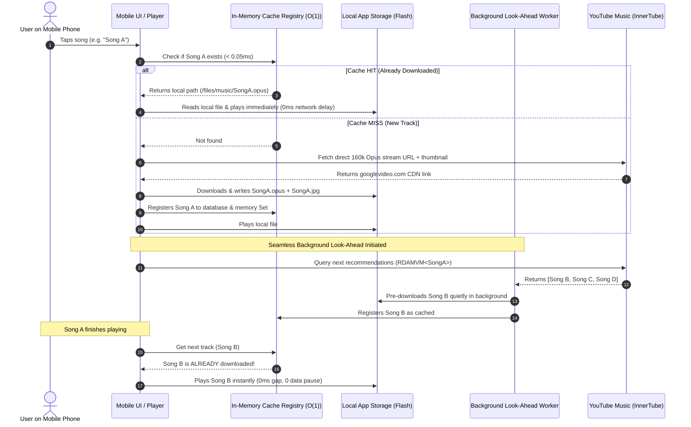

# 🎵 Soko Music Mobile (Offline-First AI Music Companion)

> **Autonomous, Standalone Mobile Music Engine**: Powered by YouTube Music's global discovery and personalized recommendation algorithm, but engineered with a **Download-First Look-Ahead Architecture** that caches tracks locally before playing, ensuring zero-latency seeking, zero-buffering playback, and complete offline resiliency.

---

## 🌟 Key Architectural Highlights

1. **Standalone & 100% Mobile**:
   - Zero PC, bridge, or external workstation dependency. Everything from YouTube Music API extraction to high-bitrate Opus downloading and playback happens natively on the phone.
2. **Download-First Look-Ahead Pipeline**:
   - **Track 1**: Downloaded once into local storage and played.
   - **Track 2+ (Up-Next Queue)**: While Track 1 is playing, an autonomous background worker quietly pre-downloads the next recommended tracks. When Track 1 ends, Track 2 plays **instantly with 0ms gap**.
3. **Sub-Millisecond O(1) In-Memory Deduplication**:
   - Every song is indexed by its immutable 11-character YouTube video ID.
   - Before firing any network request, an in-memory `Set` lookup (`< 0.05ms`) checks if the song exists locally. If found, it plays straight from local flash storage with **0 bytes of data consumed**.
4. **Rich YouTube Music Discovery Feeds**:
   - **Home & Quick Picks**: Dynamic algorithmic shelves (`FEmusic_home`).
   - **Top 100 Charts & Trending**: Real-time country-localized hits (`FEmusic_charts`).
   - **Infinite Song Radios**: Continuous genre- and mood-matched tracks via `RDAMVM<id>`.
   - **Explore & Moods**: Deep Focus, Workout, Chill, Lo-Fi, and Party stations.
5. **Anti-Abuse & Anti-Flagging Architecture**:
   - Client requests execute directly from the user's mobile cellular/Wi-Fi connection (`ANDROID_MUSIC` client spoofing) rather than flagged datacenter proxy IPs.
   - Session persistence (`visitorData`) and natural human-like request debouncing (400ms).
6. **Smart Local Storage & LRU Pruning**:
   - Multi-tiered storage: Binary audio (`.opus`/`.m4a`) in app-specific storage, relational metadata in SQLite/Room/IndexedDB.
   - Automated LRU (Least Recently Used) cache pruning to guarantee storage never exceeds user-configured limits (e.g. 4 GB), while permanently pinning user-favorited songs.
7. **Premium Glassmorphic Mobile UI/UX**:
   - Designed strictly according to the `mobile-ui-designer` & `ui-ux-designer` standards:
   - Full safe-area inset adaptation (`env(safe-area-inset-top)` / `bottom`).
   - Ergonomic 48px+ touch targets in the lower two-thirds thumb reach zone.
   - Fluid responsiveness verified across compact 360px Android viewports up to large flagships.
   - Live soundwave audio visualizer, lock-screen MediaSession integration, and lyrics drawer.

---

## 📂 Project Directory Structure

```
soko-music-app/
├── README.md                                  # Master architectural guide & quick start
├── PRODUCTION_READINESS.md                    # Verification audit, performance SLAs & checklists
├── package.json                               # App manifest & dependencies
├── assets/
│   ├── logo.svg                               # Scalable vector app brand mark
│   └── logo.png                               # High-res squircle mobile icon
├── docs/
│   └── architecture/
│       ├── 01-offline-first-pipeline.md       # Pre-fetching queue & zero-gap handoff
│       ├── 02-innertube-feed-and-recommendation.md # InnerTube endpoints, client spoofing & radios
│       ├── 03-storage-and-sqlite-schema.md    # Multi-tier storage, indexes & LRU eviction
│       ├── 04-audio-and-playback-engine.md    # Format 251 Opus extraction & MediaSession
│       └── 05-ui-ux-design-system.md          # Glassmorphic design tokens & accessibility
├── apps/
│   └── mobile/
│       ├── index.html                         # High-performance responsive mobile web/PWA app
│       └── companion/                         # Android WebView / Companion wrapper assets
├── scripts/
│   ├── preview.sh                             # Multi-device mobile viewport auditor
│   └── build.sh                               # Android APK & asset compilation pipeline
└── tests/
    └── cache_test.js                          # In-memory deduplication & LRU unit tests
```

---

## ⚡ The Download-First Look-Ahead Flow



---

## 🚀 Quick Start & Testing

### 1. Launch Mobile Development Server
```bash
cd /home/saurabh/coding/soko-music-app
bash scripts/preview.sh
```

### 2. Run Visual Mobile Audits (Pixel, iPhone, Compact)
```bash
mobile-preview --file apps/mobile/index.html --device pixel --audit
```

---

## 📜 License
MIT License. Built for seamless, offline-first personal media freedom.
