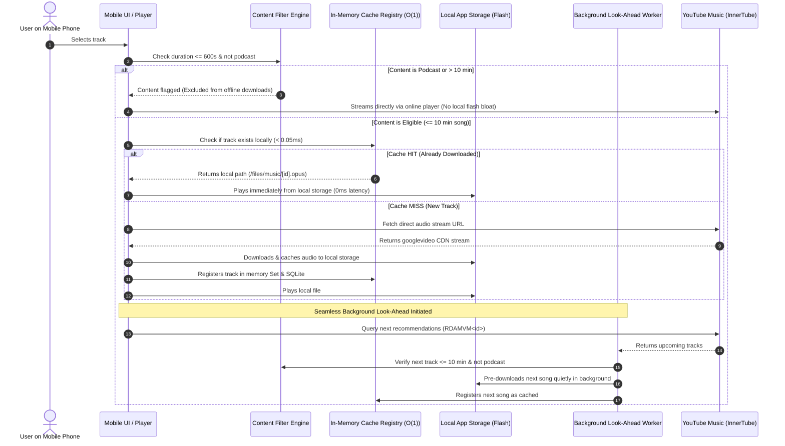

# 🎵 Soko Music Mobile (Offline-First AI Music Companion)

> **Autonomous, Standalone Mobile Music Engine**: Powered by YouTube Music's global discovery and personalized recommendation algorithm, engineered with a **Download-First Look-Ahead Architecture** that caches tracks locally before playing, ensuring zero-latency seeking, zero-buffering playback, strict content filtering (excluding podcasts and tracks > 10 min), and complete offline resiliency.

---

## 🌟 Key Architectural Highlights

1. **Standalone & 100% Mobile**:
   - Zero external proxy or workstation dependency. YouTube Music InnerTube feed extraction, 160 kbps Opus downloading, and DSP audio offload occur natively on the device.
2. **Download-First Look-Ahead Pipeline**:
   - **Track 1**: Downloaded once into local flash storage and played.
   - **Track 2+ (Up-Next Queue)**: While Track 1 plays, a background worker pre-downloads upcoming tracks. When Track 1 finishes, Track 2 plays **instantly with 0ms gap**.
3. **Smart Content Filtering Engine (10-Minute & Podcast Exclusion)**:
   - Enforces a 600-second (10-minute) ceiling across the ingestion and download pipeline.
   - Filters out podcasts, full episodes, and long audio mixes from Browse Shelves, Search, Radio Queues, and Playlist Resolution.
   - Blocks manual downloads and look-ahead pre-fetching for any content exceeding 10 minutes or flagged as podcast material.
4. **Sub-Millisecond O(1) In-Memory Deduplication**:
   - Indexed by immutable 11-character YouTube video IDs.
   - Fast `< 0.05ms` `Set` check verifies local presence before firing network requests, saving mobile data.
5. **Rich YouTube Music Discovery Feeds**:
   - **Home & Quick Picks**: Algorithmic horizontal line-cards and carousels (`FEmusic_home`).
   - **Top 100 Charts & Trending**: Real-time country-localized hits for Global, India, US, and UK.
   - **Dynamic Song Radio**: Continuous genre- and mood-matched tracks via `RDAMVM<id>`.
6. **Smart Local Storage & LRU Eviction**:
   - Multi-tiered storage: Binary audio (`.opus`/`.m4a`) in app-sandboxed directories, metadata in SQLite/IndexedDB.
   - Automatic LRU cache pruning respecting user-configured storage limits while permanently protecting favorites.
7. **Production Glassmorphic UI/UX**:
   - Safe-area inset adaptation (`env(safe-area-inset-top)` / `bottom`).
   - Ergonomic $\ge 48\times 48\text{px}$ touch targets within thumb reach zones.
   - Live soundwave visualizer, MediaSession lock-screen controls, and pull-to-refresh feed hydration.

---

## 📂 Project Directory Structure

```
soko-music-app/
├── .gitignore                                 # Clean gitignore for builds, dex, and caches
├── package.json                               # npm scripts (test, build, build:apk, preview)
├── README.md                                  # Human-readable master overview & quick start
├── apps/
│   ├── mobile/                                # Mobile Web / PWA Single-Page Application
│   │   ├── index.html                         # Core client application & UI
│   │   └── assets -> ../../assets             # Symlink to shared assets
│   └── android/                               # Android native platform assets
│       ├── res/                               # Android launcher mipmaps & drawables
│       │   ├── drawable/
│       │   ├── mipmap-mdpi/
│       │   ├── mipmap-hdpi/
│       │   ├── mipmap-xhdpi/
│       │   ├── mipmap-xxhdpi/
│       │   └── mipmap-xxxhdpi/
│       └── keystore/                          # Release signing keystore
│           └── soko_music.keystore
├── assets/                                    # Static assets, branding & bundled media
│   ├── logo.svg                               # Brand vector logo
│   ├── logo.png                               # Brand raster icon
│   ├── icon.png                               # Launcher icon
│   ├── regional_charts.json                   # 400 Real Regional Chart tracks (100 per region)
│   └── music/                                 # Bundled local Opus audio and cover art
├── dist/                                      # Packaged production distribution outputs
│   ├── index.html                             # Compiled standalone web bundle
│   ├── assets/                                # Bundled static assets
│   └── soko-music.apk                         # Signed release Android APK
├── docs/                                      # Technical architecture & specifications
│   ├── ARCHITECTURE.md                        # Master architectural design & telemetry loop
│   ├── PRODUCTION_READINESS.md                # SLAs, verification checklist & invariants
│   ├── architecture/                          # Architectural modules
│   │   ├── 01-offline-first-pipeline.md       # Pre-fetching queue & zero-gap handoff
│   │   ├── 02-innertube-feed-and-recommendation.md # InnerTube endpoints, radios & feeds
│   │   ├── 03-storage-and-sqlite-schema.md    # Multi-tier storage & LRU cache eviction
│   │   ├── 04-audio-and-playback-engine.md    # Opus extraction & dual-audio immunity
│   │   ├── 05-ui-ux-design-system.md          # Design tokens & touch ergonomics
│   │   └── 06-content-filtering-and-podcast-exclusion.md # 10-minute ceiling & podcast exclusion
│   └── screenshots/                           # Curated visual verification assets
│       ├── device/                            # Physical Android device playback captures
│       ├── audits/                            # Viewport audits & layout validation JSONs
│       ├── ui/                                # UI previews, tabs, and modal states
│       └── brand/                             # Branding vector and raster iterations
├── scripts/                                   # Build automation & utility toolchain
│   ├── build.sh                               # Packages web distribution into dist/
│   ├── build_apk.sh                           # Compiles, zipaligns & signs release APK
│   ├── generate_icons.py                      # Generates multi-density Android launcher icons
│   ├── preview.sh                             # Multi-device mobile viewport auditor
│   └── tools/                                 # Offline tools & charts fetchers
│       ├── fetch_real_charts.js               # Fetches authentic YouTube regional chart data
│       └── build_full_html.js                 # HTML generation utility
└── tests/                                     # Automated test suites
    ├── cache_test.js                          # In-memory O(1) deduplication & LRU unit tests
    └── comprehensive_test.js                  # 204-test comprehensive verification suite
```

---

## ⚡ Download-First Look-Ahead Flow



---

## 🚀 Quick Start & Development

### 1. Run Automated Tests
```bash
# Run entire test suite (204 automated tests)
npm test

# Run unit cache tests only
npm run test:unit

# Run full comprehensive verification suite
npm run test:comprehensive
```

### 2. Build Web Distribution Package
```bash
npm run build
# Outputs to dist/
```

### 3. Build Signed Android APK
```bash
npm run build:apk
# Compiles, zipaligns, signs with persistent keystore -> dist/soko-music.apk
```

### 4. Local Mobile Preview
```bash
npm run preview
```

---

## 📚 Technical Documentation Directory

- [Master Architecture & Telemetry Loop](docs/ARCHITECTURE.md)
- [Production Readiness & Performance SLAs](docs/PRODUCTION_READINESS.md)
- [Module 1: Offline-First Pipeline](docs/architecture/01-offline-first-pipeline.md)
- [Module 2: InnerTube Feeds & Recommendation](docs/architecture/02-innertube-feed-and-recommendation.md)
- [Module 3: Storage & SQLite Schema](docs/architecture/03-storage-and-sqlite-schema.md)
- [Module 4: Audio Playback Engine & Dual-Audio Immunity](docs/architecture/04-audio-and-playback-engine.md)
- [Module 5: Mobile UI/UX Design System](docs/architecture/05-ui-ux-design-system.md)
- [Module 6: Content Filtering & Podcast Exclusion](docs/architecture/06-content-filtering-and-podcast-exclusion.md)

---

## 📜 License
MIT License. Built for seamless, offline-first personal media freedom.
