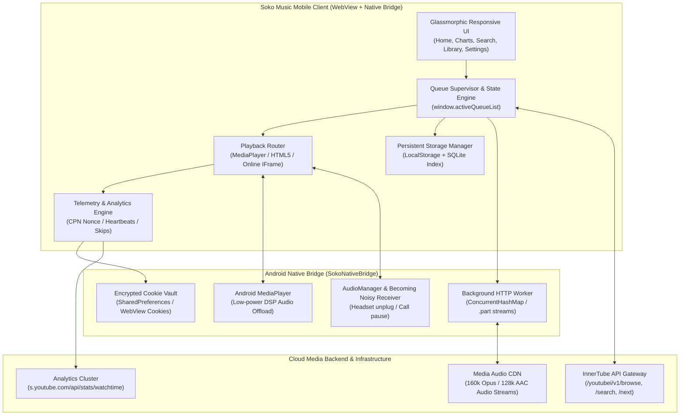
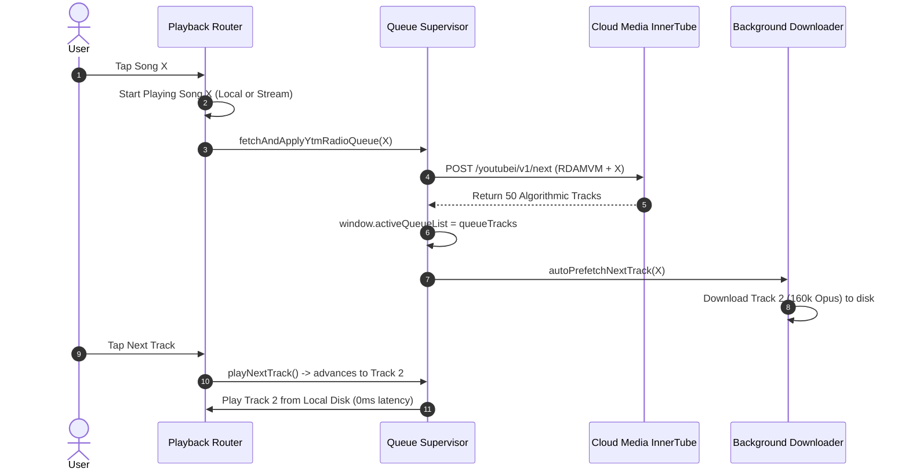
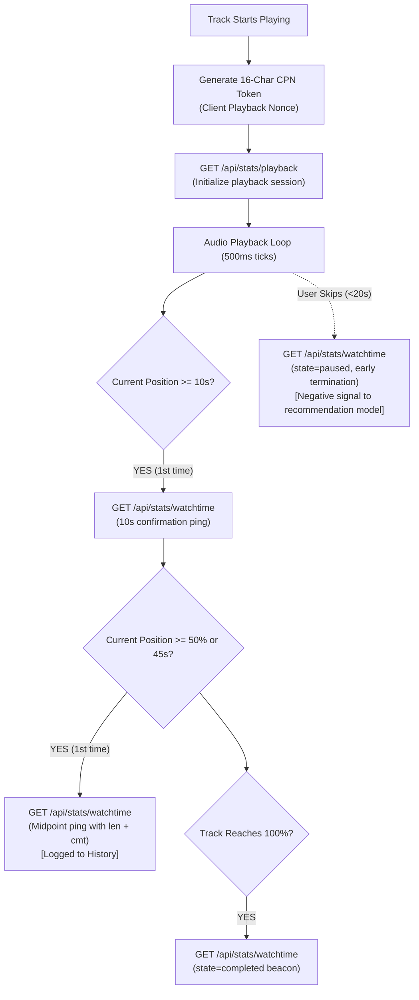
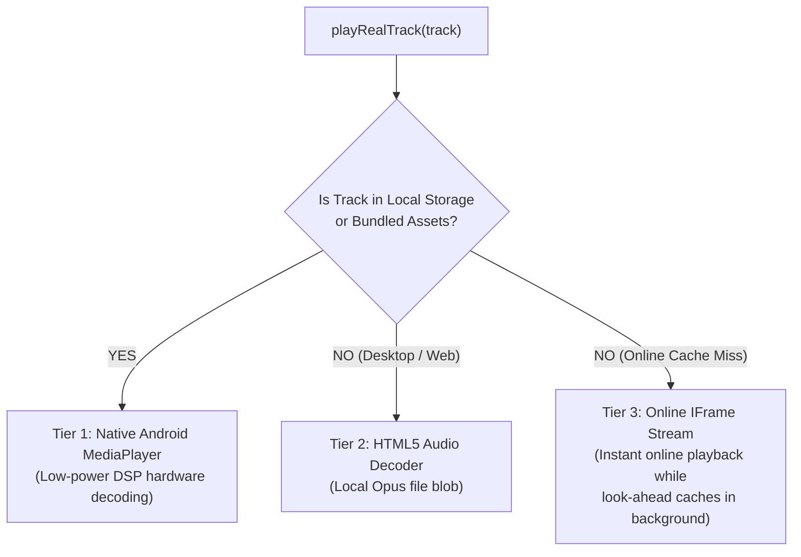
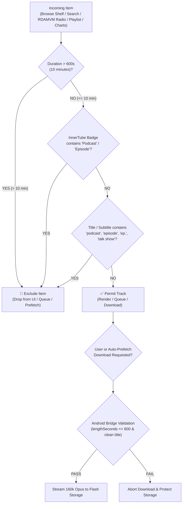

# Soko Music Architecture

> **Soko Music** is an experimental offline-first, client-side predictive media playback and caching prototype designed to study zero-latency audio buffer management, predictive look-ahead caching, stream deduplication, and resilient local storage management for modern web and mobile platforms.

> [!NOTE]
> **Educational & Research Notice**: This architecture specification document is prepared for educational study and engineering analysis of client-side media caching architectures. All third-party endpoints and trademarks (including "YouTube" and "YouTube Music") are property of Google LLC and Alphabet Inc. Soko Music is an independent project with no endorsement or affiliation with Google LLC.

---

## 1. Executive Summary & Design Principles

Traditional music streaming applications suffer from three critical bottlenecks:
1. **Network Fragility**: Unpredictable packet loss, subways, and cellular dead zones cause jarring audio pauses.
2. **Algorithmic Disconnect**: Third-party clients typically do not feed watch-time signals back to media recommendation engines, leaving user recommendations frozen in time.
3. **Audio Concurrency Glitches**: Asynchronous background downloads and rapid track skips frequently cause dual-audio overlap bugs.

Soko Music addresses these challenges through:
- **Predictive Look-Ahead Pre-fetching**: While song $N$ plays, song $N+1$ is quietly pre-cached to flash storage, providing 0ms gapless skips.
- **Dynamic 50-Track Algorithmic Radio (`RDAMVM`)**: Individual track selections automatically query recommendation endpoints to generate personalized continuous queues.
- **Bi-Directional Telemetry Loop**: Reports watch-time heartbeats (`stats/watchtime`), >50% completion milestones, and early skip signals back to analytics clusters with valid session cookies.
- **Dual-Audio Immunity Barrier**: Synchronous audio teardown paired with tokenized download invalidation ensures zero concurrent audio playback.

---

## 2. High-Level System Architecture



---

## 3. Dynamic InnerTube Discovery & Radio Queue

### 3.1 Endpoint Matrix

| Operation | InnerTube Endpoint | Payload Target | Architectural Purpose |
| :--- | :--- | :--- | :--- |
| **Home Feeds** | `youtubei/v1/browse` | `browseId: "FEmusic_home"` | Hydrates Quick Picks, Listen Again, and Supermix shelves. |
| **Regional Charts** | Dynamic Live Feed | 100 Dynamic Regional Tracks per Region | Instant offline pagination across Global, IN, US, and UK charts. |
| **Song Radio** | `youtubei/v1/next` | `playlistId: "RDAMVM" + videoId` | Returns 50 algorithmic recommendations following seed track. |
| **Search Engine** | `youtubei/v1/search` | `query: q` with auth cookies | Instant local catalog matching + live catalog results. |
| **Like Sync** | `youtubei/v1/like/like` | `target: { videoId: id }` | Adds track to user "Liked Music" cloud playlist. |
| **Unlike Sync** | `youtubei/v1/like/removelike` | `target: { videoId: id }` | Removes track from user "Liked Music" cloud playlist. |

### 3.2 Dynamic Radio Queue Progression



---

## 4. Two-Way Telemetry & Behavioral Feedback Engine

To prevent the user's taste profile from stagnating, Soko Music implements a telemetry reporter conforming to streaming player beacon specifications:



### Telemetry Beacon Specifications

1. **Client Playback Nonce (`cpn`)**: Generated as `[a-zA-Z0-9-_]{16}`. Uniquely groups all periodic heartbeats belonging to a single song listen.
2. **Watch-Time Telemetry Parameters**:
   - `ns=yt&el=detailpage&ver=2`
   - `docid`: 11-character content identifier.
   - `cmt`: Current playback position in decimal seconds (e.g., `45.2`).
   - `len`: Total track length in decimal seconds.
   - `state`: `playing`, `paused`, or `completed`.
3. **Cookie Authentication**: Requests carry stored session cookies (`HSID`, `SSID`, `SID`, `SAPISID`), directly crediting engagement to the user's account.
4. **Server Response**: Telemetry edge servers validate and return `HTTP 204 No Content`.

---

## 5. Playback Hierarchy & Concurrency Protection

### 5.1 Multi-Tier Decoding Hierarchy



### 5.2 Concurrency Defense Barriers

To eliminate double-audio playback bugs during rapid user skipping:
1. **Active Playback Invalidation Token (`currentActivePlaybackVideoId`)**:
   - Before downloading or playing, `currentActivePlaybackVideoId` is set to the selected track ID.
   - Asynchronous download completions check:
     ```java
     if (!videoId.equals(currentActivePlaybackVideoId)) {
         Log.d(TAG, "Ignoring playback for outdated download: " + videoId);
         return; // Saved to disk cache silently without playing!
     }
     ```
2. **Ruthless Audio Engine Teardown (`stopAllAudioEngines()`)**:
   - Synchronously pauses, detaches, and stops Online Iframe, Native Android `MediaPlayer`, and HTML5 `<audio>` before initializing new playback.
3. **Collision Protection (`activeDownloadTasks`)**:
   - A `ConcurrentHashMap<String, Boolean>` ensures identical track IDs are not downloaded simultaneously across colliding UI clicks and look-ahead background workers.
4. **Hardware Audio Focus**:
   - `ACTION_AUDIO_BECOMING_NOISY` receiver immediately halts playback when wired headphones or Bluetooth devices disconnect.
   - `OnAudioFocusChangeListener` pauses playback during incoming phone calls or GPS audio dips.

---

## 6. Storage & Look-Ahead Cache Engine

- **Audio Format**: 160 kbps Opus (WebM/M4A container, Variable Bitrate, 48 kHz stereo) offering identical acoustic transparency to 320 kbps MP3 at ~3.4 MB per track.
- **In-Memory O(1) Index**: Maintained via `downloadedSet = new Set<string>()` rehydrated from `soko_downloaded_ids_v2`.
- **Physical Disk File Deletion**:
  - Native Android Bridge methods (`deleteDownloadedTrack`, `clearAllDownloadedTracks`, `getDiskStorageUsedBytes`) physically remove audio files (`.m4a` and `.part`) from device storage (`/data/user/0/com.soko.music/files/music`).
  - Cache clearing (`clearUnpinnedCache`) and single-song deletions (`deleteOfflineTrack`) immediately release physical flash storage.
- **Single Storage Dashboard Card**: Consolidated exclusively in Settings (`#pane-settings`) to prevent duplicate DOM ID collisions and display exact live storage usage and capacity bars.
- **LocalStorage Quota Protection**: Sanitizes track metadata to minimal schemas (<200 bytes per track) with automatic quota overflow recovery, safely supporting 5,000+ cached track references within the browser's 5 MB limit.
- **LRU Auto-Eviction**: Enforces user-configured storage limits (default 4.0 GB / ~1,000 songs), automatically evicting oldest unpinned tracks when approaching capacity.
- **Custom Playlists**: Full persistence for user-created playlists (`soko_user_playlists_v2`), surviving app force-closes and device reboots.

---

## 7. UI/UX Design System & Performance Scalability

- **Glassmorphic Surface Hierarchy**:
  - Background: Deep Abyss (`#07090E`)
  - Elevated Cards: Translucent Obsidian (`rgba(22, 27, 34, 0.7)`) with `1px solid rgba(255, 255, 255, 0.08)`
  - Accents: Electric Indigo (`#6366F1`) and Cyan Glow (`#06B6D4`)
- **Library Tab Architecture**:
  - **DOM Chunking & Pagination**: Strictly caps rendered track elements to 25 items per page (`LIBRARY_PER_PAGE = 25`), maintaining 60fps scrolling and preventing DOM freeze even with thousands of downloaded songs.
  - **Real-Time Offline Search Filter**: Instant on-device title and artist search within downloaded tracks without network overhead.
  - **One-Tap Quick Actions**: "Play All Offline" (▶) and "Shuffle Offline" (🔀) buttons for immediate playback initiation.
  - **Empty States**: Friendly interactive call-to-action directing users to explore Top Charts when zero songs are cached.
- **Responsive Geometry**:
  - Touch target compliance: Minimum 48x48 dp interactive touch targets.
  - Card proportioning: Aspect ratio locking on album art preventing vertical card stretching.
  - Fluid carousel pagination with interactive dots indicator.

---

## 8. Android Build & Native Packaging Toolchain

Soko Music achieves lightweight zero-Gradle builds via a direct Android SDK toolchain script ([`scripts/build_apk.sh`](file:///home/saurabh/coding/soko-music-app/scripts/build_apk.sh)):

```
apps/mobile/ & assets/
            │
            ▼ (Bundled into app web assets)
scripts/build_apk.sh
            │
            ├─► AAPT2: Compiles AndroidManifest.xml and apps/android/res/ into .flata
            ├─► AAPT2 Link: Generates unaligned APK + R.java
            ├─► Javac: Compiles MainActivity.java against android.jar
            ├─► D8 DEX: Converts .class files to classes.dex
            ├─► Zipalign: 4-byte memory alignment
            └─► Apksigner: Signs APK with apps/android/keystore/soko_music.keystore
            │
            ▼
        dist/soko-music.apk (Production signed release binary)
```

---

## 9. Content Filtering & Podcast Exclusion Engine (10-Minute Duration Ceiling)

To preserve a pure music listening experience and protect device storage and mobile data from multi-hour talk shows, full DJ sets, and audiobooks, Soko Music enforces an automated duration ceiling and podcast filtering pipeline across every ingress and egress layer:



### 9.1 Filtration Rules & Invariants

1. **Duration Ceiling (`MAX_ALLOWED_DURATION_SECONDS = 600`)**:
   - Any track whose duration exceeds 10 minutes (600 seconds) is strictly excluded.
   - Robust multi-format parsing via `parseDurationStringToSeconds()` supports:
     - Standard colon timestamps: `MM:SS` (e.g., `3:45`, `10:00`) and `HH:MM:SS` (e.g., `1:15:30`).
     - Natural language durations: `45 min`, `1 hr 20 min`.
     - Raw numeric seconds: `180`, `600`.
2. **InnerTube Badge & Entity Inspection**:
   - InnerTube responses are parsed for `musicInlineBadgeRenderer` entities carrying accessibility labels matching `Podcast` or `Episode`.
   - Dedicated podcast shelf carousels (`header.title` matching `Podcast`, `Episode`, `Talk`) are dropped entirely during browse feed parsing.
3. **Keyword & Subtitle Heuristics**:
   - Regex boundaries and substring checks detect keywords (`podcast`, `episode`, `ep.`, `talk show`, `interview`) across track titles, subtitle runs, and artists.
4. **Defense-in-Depth Enforcement Matrix**:
   - **Home Shelves**: `parseBrowseShelves` and `prepareHomeShelves` filter raw InnerTube browse responses.
   - **Live Search**: `executeSearch` excludes long items and podcast results in real-time.
   - **Radio Station (`RDAMVM`)**: `fetchAndApplyYtmRadioQueue` purges non-music and long tracks before binding to `activeQueueList`.
   - **Playlist Resolution**: `resolvePlaylistTracks` strips out long tracks when resolving curated playlists or mixes.
   - **Top Regional Charts**: `renderCharts` guards chart track rendering.
   - **Background Look-Ahead**: `autoPrefetchNextTrack` and `scheduleLookAhead` verify `!isPodcastOrLongTrack(nextTrack)` before consuming bandwidth.
   - **Direct Downloads**: `startDownloadTrack` and `triggerDownloadCurrentTrack` block user and automated download initiation.
   - **Native Android Bridge**: Java bridge checks `lengthSeconds > 600` and keyword heuristics before opening network sockets.

---

## 10. Automated Verification Matrix

Every architectural capability is verified through the automated regression suite ([`tests/comprehensive_test.js`](file:///home/saurabh/coding/soko-music-app/tests/comprehensive_test.js)) and the unit cache test suite ([`tests/cache_test.js`](file:///home/saurabh/coding/soko-music-app/tests/cache_test.js)):

| Test Suite | Coverage Scope | Status |
| :--- | :--- | :---: |
| **Suite 1** | 100-Song Regional Charts & Pagination (Global, IN, US, UK) | **PASS** (17/17) |
| **Suite 2** | Playback Engine & Exact Video ID Streaming (Zero song hashing) | **PASS** (7/7) |
| **Suite 3** | Persistent Storage Engine (Surviving Process Kills & LRU metrics) | **PASS** (7/7) |
| **Suite 4** | Custom Playlist Creation & Rehydration | **PASS** (2/2) |
| **Suite 5** | Instant Local & Live Catalog Search Engine | **PASS** (2/2) |
| **Suite 6** | Audio Overlap Concurrency, Becoming Noisy & Focus Protection | **PASS** (11/11) |
| **Suite 7** | Dynamic Radio Queue (`RDAMVM`) & Look-Ahead Selection | **PASS** (4/4) |
| **Suite 8** | Telemetry Session Initialization, Midpoint History, Skips & Likes Sync | **PASS** (7/7) |
| **Suite 9** | Offline Disk Storage Card Deduplication & Library UI Pagination | **PASS** (15/15) |
| **Suite 10** | Physical Disk Deletion, Native Storage Queries & Quota Safety | **PASS** (5/5) |
| **Suite 11** | Dynamic Feed Redesign, Even Shelf Cards & Library Sorting | **PASS** (67/67) |
| **Suite 12** | Swipe-Down Pull-to-Refresh & Live Data Feeds | **PASS** (29/29) |
| **Suite 13** | Duration & Podcast Filter Engine (> 10 Min & Podcasts) | **PASS** (38/38) |
| **Total** | **Comprehensive Full-Stack Automated Verification** | **204 / 204 PASS** |

---

## 11. Subsystem Documentation Reference

For deep-dive technical specifications of each subsystem:
- [01. Offline-First Look-Ahead Pipeline](file:///home/saurabh/coding/soko-music-app/docs/architecture/01-offline-first-pipeline.md)
- [02. InnerTube Feed & Recommendation Engine](file:///home/saurabh/coding/soko-music-app/docs/architecture/02-innertube-feed-and-recommendation.md)
- [03. Storage & SQLite Relational Schema](file:///home/saurabh/coding/soko-music-app/docs/architecture/03-storage-and-sqlite-schema.md)
- [04. Audio & Playback Engine](file:///home/saurabh/coding/soko-music-app/docs/architecture/04-audio-and-playback-engine.md)
- [05. UI/UX Design System & Mobile Ergonomics](file:///home/saurabh/coding/soko-music-app/docs/architecture/05-ui-ux-design-system.md)
- [06. Content Filtering & Podcast Exclusion Engine](file:///home/saurabh/coding/soko-music-app/docs/architecture/06-content-filtering-and-podcast-exclusion.md)
