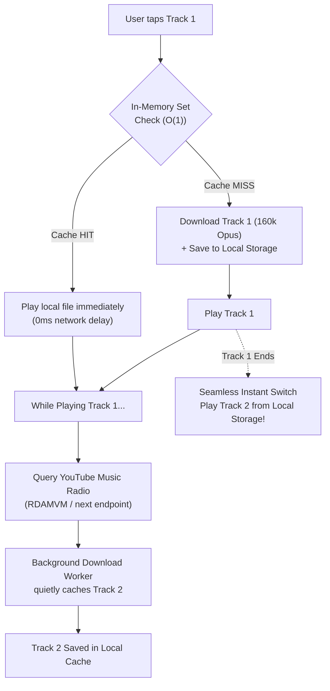

# Architecture: Offline-First Look-Ahead Pipeline

> **Core Philosophy**: Mobile networks are unpredictable—cell towers drop in subways, tunnels, and elevators. Soko Music eliminates buffering by transforming streaming into an autonomous **Look-Ahead Download Queue**.

---

## 1. The Look-Ahead Lifecycle

Standard streaming players wait for the user to reach the end of a track before requesting the next chunk over the network. If the user loses reception, music abruptly cuts out.

In Soko Music:
1. **Immediate Playback**: The currently selected song is either loaded from local cache (0ms) or downloaded rapidly (~1–3s for 3.5MB Opus) and played immediately.
2. **Quiet Look-Ahead Pre-fetch**:
   - Within 15 seconds of playback starting on Track $N$, the queue manager queries the YouTube Music `next` recommendation endpoint (`RDAMVM<current_id>`).
   - The background worker begins pre-downloading Track $N+1$ into local storage.
3. **Zero-Gap Track Transition**:
   - When Track $N$ finishes, Track $N+1$ is already residing on local flash storage.
   - Playback starts with **0 milliseconds buffering** and zero network dependencies.

---

## 2. Cancellation Watchdog (Rapid Skip Protection)

When users rapidly skip 3 or 4 tracks in a row:
- The queue supervisor immediately sends a cancellation signal (aborting active HTTP byte streams).
- Unfinished `.part` temporary files are pruned from disk immediately.
- The worker re-allocates bandwidth to the newly selected track, preventing network congestion and battery drain.

---

## 3. Battery & CPU Efficiency

- Download workers run on low-priority background isolates/threads.
- Audio chunks are piped directly to disk without intermediate memory bloat.
- CPU power states drop to minimum once the 3.5 MB file is written to flash, allowing the Android OS to enter low-power audio offload mode.

---

## 4. Content Filtering & Look-Ahead Safety Guard

Before triggering look-ahead pre-fetching for Track $N+1$, the candidate track is validated against `isPodcastOrLongTrack(nextTrack)`:
- If the track duration exceeds 10 minutes (600 seconds) or matches podcast heuristics, background pre-fetching is immediately skipped.
- This ensures mobile data is never spent caching multi-hour talk shows, full DJ sets, or podcast episodes.
- For detailed filter rules and implementation specifications, see [06. Content Filtering & Podcast Exclusion Engine](file:///home/saurabh/coding/soko-music-app/docs/architecture/06-content-filtering-and-podcast-exclusion.md).
