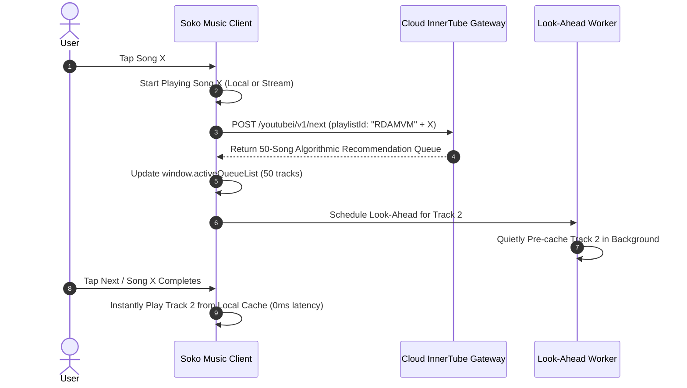
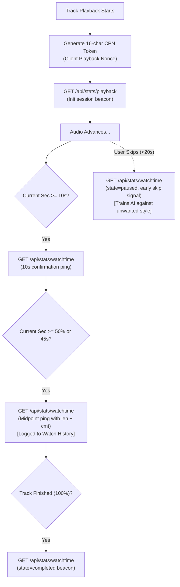

# Architecture: InnerTube Feed & Recommendation Engine

> **Feature Goal**: Provide dynamic media discovery—Top Charts, Infinite Song Radios, Quick Picks, and Mood Stations—while maintaining responsive performance and efficient caching.

---

## 1. InnerTube Client Persona & Headers

The client communicates with the standard InnerTube API specification:

```json
{
  "context": {
    "client": {
      "clientName": "ANDROID_MUSIC",
      "clientVersion": "6.40.52",
      "androidSdkVersion": 34,
      "osName": "Android",
      "osVersion": "14",
      "gl": "US",
      "hl": "en"
    }
  }
}
```

### Critical HTTP Headers
```http
User-Agent: com.google.android.apps.youtube.music/6.40.52 (Linux; U; Android 14; en_US; Pixel 8)
X-YouTube-Client-Name: 21
X-YouTube-Client-Version: 6.40.52
Content-Type: application/json
```

---

## 2. Dynamic Feed & Radio Queue Matrix

| Feed Target | Endpoint | Parameters / Payload | UI / Queue Target |
| :--- | :--- | :--- | :--- |
| **Home Feeds** | `/youtubei/v1/browse` | `{"browseId": "FEmusic_home"}` | Quick Picks, Listen Again, Forgotten Favorites |
| **Charts & Trending** | Statically Cached & Paginated | 100 Dynamic Regional Tracks per Region | Regional Charts (Global, India, US, UK) |
| **Dynamic Song Radio** | `/youtubei/v1/next` | `{"videoId": id, "playlistId": "RDAMVM" + id, "isAudioOnly": true}` | 50-track dynamic algorithmic Up Next queue |
| **Search Engine** | `/youtubei/v1/search` | `{"query": q}` with User Auth Cookies | Instant Local + Live Catalog Results with History Sync |
| **Favorites / Like Sync** | `/youtubei/v1/like/like` | `{"target": {"videoId": id}}` | Liked Music auto-playlist synchronization |
| **Favorites / Unlike Sync** | `/youtubei/v1/like/removelike`| `{"target": {"videoId": id}}` | Removal from Liked Music auto-playlist |

---

## 3. Dynamic Algorithmic Radio Queue (`RDAMVM`)

When a user taps an individual track from Home or Search, Soko Music avoids static track looping by initializing an algorithmic radio station:



---

## 4. Two-Way Telemetry & Engagement Feedback Loop

To prevent the user's recommendation profile from freezing, Soko Music reports continuous telemetry beacons directly to the media analytics servers:



### Telemetry Beacons Breakdown

1. **Session Nonce (`cpn`)**: Generated as a 16-character cryptographically random token tying all playback beacons for a single listening session together.
2. **Watch-Time Telemetry (`api/stats/watchtime`)**:
   - `ns=yt&el=detailpage&ver=2`
   - `cmt`: Current media playback position in fractional seconds.
   - `len`: Total audio duration in seconds.
   - `state`: `playing`, `paused`, or `completed`.
3. **HTTP 204 Verification**: The analytics cluster responds with standard `204 No Content`, confirming that the playback event was successfully logged to the user's profile without data overhead.

---

## 5. Anti-Flagging Hygiene

1. **Distributed Residential/Mobile IPs**: Because each user makes calls from their own mobile carrier IP, requests are never classified as datacenter scraping bots.
2. **Session Consistency**: The client maintains persistent authentication cookies (`HSID`, `SSID`, `SID`, `SAPISID`) via encrypted Android SharedPreferences and WebView cookie vaults.
3. **Debounced Search Dispatch**: User keyboard input is throttled by `350ms` to prevent burst floods.

---

## 6. Feed Sanitization & Content Filtering

All raw responses received from InnerTube endpoints (`/youtubei/v1/browse`, `/youtubei/v1/search`, `/youtubei/v1/next`) pass through `parseBrowseShelves`, `prepareHomeShelves`, and `isPodcastOrLongTrack(item)` before hydration into UI views or queue state:
- **Shelf Pruning**: Carousel shelves carrying podcast indicators (`header.title` containing "Podcast", "Episode", or "Talk") are dropped during browse parsing.
- **Item Pruning**: Individual tracks exceeding 600s (10 minutes) or carrying podcast badges/keywords are filtered out of home feeds, search results, dynamic radio queues (`RDAMVM`), and playlist resolutions.
- For complete technical specifications, see [06. Content Filtering & Podcast Exclusion Engine](file:///home/saurabh/coding/soko-music-app/docs/architecture/06-content-filtering-and-podcast-exclusion.md).
