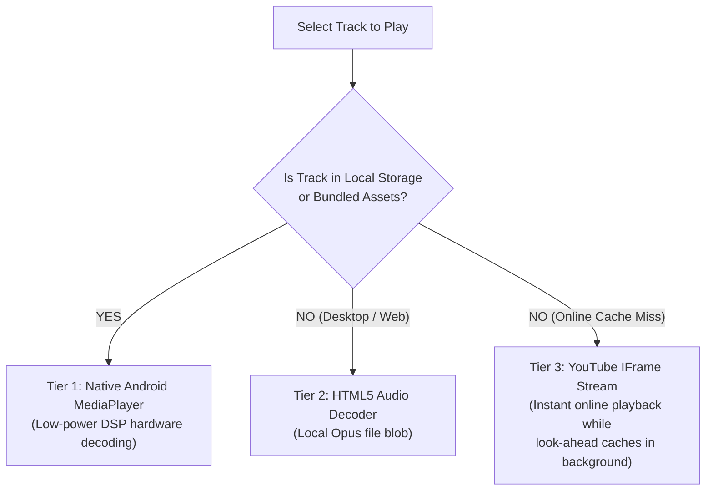
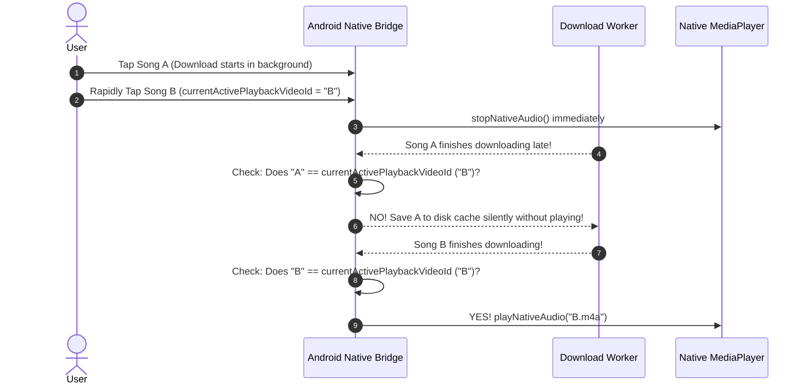

# Architecture: Audio & Playback Engine

> **Objective**: Bit-perfect, seekable audio playback utilizing native OS decoders (ExoPlayer / Media3 / HTML5 Audio) with lock-screen media controls and low-power hardware offloading.

---

## 1. Format Selection: Why 160 kbps Opus (Format 251)?

YouTube delivers two primary audio-only streams:
- **Format 251 (Opus / WebM)**: ~160 kbps VBR (Variable Bitrate), 48 kHz stereo.
- **Format 140 (AAC / MP4)**: ~128 kbps CBR (Constant Bitrate), 44.1 kHz stereo.

Soko Music prioritizes **Format 251 Opus**:
- Opus matches or exceeds the acoustic transparency of 256–320 kbps MP3 while using ~40% less bandwidth and disk storage (~3.2 MB per 3.5 minute track).
- Modern Android devices (Android 5.0+) decode Opus in hardware DSPs with virtually zero battery impact.

---

## 2. Multi-Tier Playback Hierarchy

Soko Music uses an intelligent 3-tier playback fall-through hierarchy:



---

## 3. Dual-Audio Overlap Immunity Architecture

To guarantee that two songs **never** play simultaneously across fast user skips and out-of-order download completions, Soko Music enforces 3 defensive barriers:



1. **Active Playback Invalidation Token (`currentActivePlaybackVideoId`)**:
   - Every song selection sets `currentActivePlaybackVideoId = videoId`.
   - When any asynchronous background download completes, the completion callback executes:
     ```java
     if (!videoId.equals(currentActivePlaybackVideoId)) {
         Log.d(TAG, "Ignoring playback for outdated download: " + videoId);
         return; // Saved to disk cache, but never starts audio!
     }
     ```
2. **Synchronous Audio Engine Teardown (`stopAllAudioEngines()`)**:
   - Before any track begins, all three audio engines (YouTube Iframe, Native Android MediaPlayer, HTML5 `<audio>`) are synchronously paused, cleared, and reset.
3. **In-Flight Colliding Write Protection (`activeDownloadTasks`)**:
   - Managed via `ConcurrentHashMap<String, Boolean>` to prevent parallel conflicting file-streams to `.part` files if the user taps a track while the look-ahead worker is already caching it.

---

## 4. Hardware Audio Focus & Interruption Handling

1. **Headset Unplug / Bluetooth Disconnect**:
   - Registered `ACTION_AUDIO_BECOMING_NOISY` BroadcastReceiver instantly pauses playback when wired headphones or Bluetooth earbuds are disconnected, preventing unintended loudspeaker playback in public.
2. **Phone Calls & Navigation Dips (`OnAudioFocusChangeListener`)**:
   - `AUDIOFOCUS_LOSS`: Immediately pauses audio and releases lock-screen notification.
   - `AUDIOFOCUS_LOSS_TRANSIENT`: Pauses playback during incoming phone calls or alarms.
   - `AUDIOFOCUS_GAIN`: Resumes playback once the interruption clears.

---

## 5. Lock-Screen MediaSession Integration

The playback engine binds to Android's native `MediaSessionManager` and `NotificationManager`:

```javascript
if ('mediaSession' in navigator) {
  navigator.mediaSession.metadata = new MediaMetadata({
    title: track.title,
    artist: track.artist,
    album: 'Soko Music Library',
    artwork: [
      { src: track.cover, sizes: '512x512', type: 'image/jpeg' }
    ]
  });

  navigator.mediaSession.setActionHandler('play', () => togglePlayPause());
  navigator.mediaSession.setActionHandler('pause', () => togglePlayPause());
  navigator.mediaSession.setActionHandler('previoustrack', () => playPreviousTrack());
  navigator.mediaSession.setActionHandler('nexttrack', () => playNextTrack());
  navigator.mediaSession.setActionHandler('seekto', (details) => {
    if (details.seekTime) seekTrack(details.seekTime);
  });
}
```

---

## 6. Pre-Playback Duration & Content Validation

Before initializing playback or background look-ahead caching:
- Track duration is parsed via `parseDurationStringToSeconds(track.duration)` and validated against the 600-second threshold.
- Items identified as podcasts or exceeding 10 minutes are prevented from triggering look-ahead downloads or offline caching.
- See [06. Content Filtering & Podcast Exclusion Engine](file:///home/saurabh/coding/soko-music-app/docs/architecture/06-content-filtering-and-podcast-exclusion.md).
