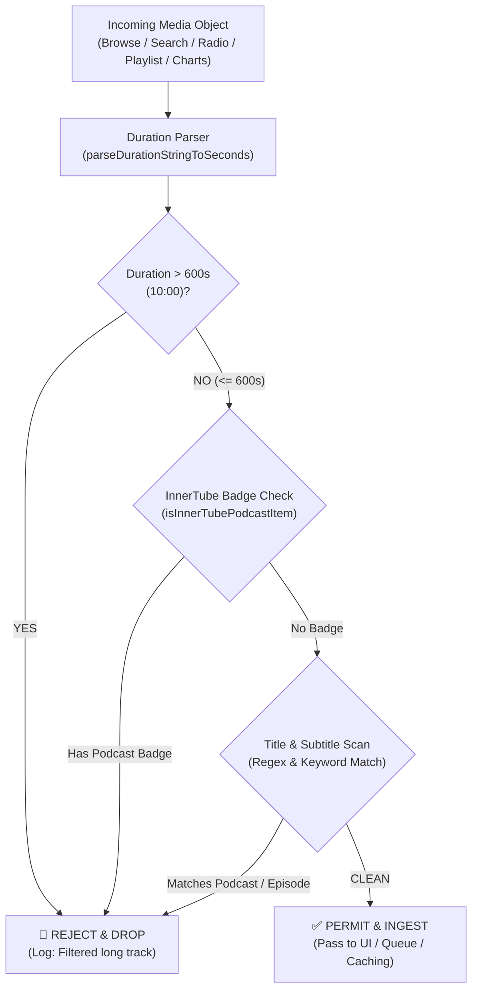

# Architecture: Content Filtering & Podcast Exclusion Engine

> **Core Philosophy**: Soko Music is engineered exclusively for high-fidelity music streaming. Non-musical content—such as podcasts, talk shows, news broadcasts, multi-hour DJ marathons, and audiobooks—degrades recommendation radio quality, consumes tens of megabytes of cellular data, and rapidly exhausts sandboxed flash storage. Soko Music enforces an uncompromising, multi-tier defense system that filters out all content exceeding 10 minutes or exhibiting podcast signatures.

---

## 1. System Invariants & Filtering Heuristics

Every piece of media ingested from YouTube Music's InnerTube endpoints or initiated via user interactions must satisfy two core invariants:

1. **Duration Ceiling**: $\text{Duration} \le 600\text{ seconds}$ (10 minutes).
2. **Podcast Nonce Exemption**: Content must not possess podcast badges, podcast metadata runs, or episodic titles.



---

## 2. Multi-Format Duration Normalization

YouTube Music returns track durations in multiple non-standard formats across browse shelves, search lists, and radio queue objects. The normalization function `parseDurationStringToSeconds(durationStr)` handles all variations:

| Inbound Format | Example Input | Normalized Seconds | Filter Disposition |
| :--- | :--- | :---: | :---: |
| **Standard MM:SS** | `"3:45"` | `225s` | **Permitted** ($\le 600\text{s}$) |
| **Maximum Threshold** | `"10:00"` | `600s` | **Permitted** ($\le 600\text{s}$) |
| **Over Threshold** | `"10:01"` | `601s` | **Rejected** ($> 600\text{s}$) |
| **Hour Timestamp** | `"1:15:30"` | `4,530s` | **Rejected** ($> 600\text{s}$) |
| **Natural Language** | `"45 min"` | `2,700s` | **Rejected** ($> 600\text{s}$) |
| **Natural Language** | `"1 hr 20 min"` | `4,800s` | **Rejected** ($> 600\text{s}$) |
| **Numeric Seconds** | `180` | `180s` | **Permitted** ($\le 600\text{s}$) |

```javascript
function parseDurationStringToSeconds(durationStr) {
  if (typeof durationStr === 'number') return durationStr;
  if (!durationStr || typeof durationStr !== 'string') return 0;
  var s = durationStr.trim().toLowerCase();
  
  if (s.includes(':')) {
    var parts = s.split(':').map(function(p) { return parseInt(p, 10) || 0; });
    if (parts.length === 2) return parts[0] * 60 + parts[1];
    if (parts.length === 3) return parts[0] * 3600 + parts[1] * 60 + parts[2];
  }
  
  if (s.includes('hr') || s.includes('hour')) {
    var hrMatch = s.match(/(\d+)\s*(?:hr|hour)/);
    var minMatch = s.match(/(\d+)\s*min/);
    var hrs = hrMatch ? parseInt(hrMatch[1], 10) : 0;
    var mins = minMatch ? parseInt(minMatch[1], 10) : 0;
    return hrs * 3600 + mins * 60;
  }
  
  if (s.includes('min')) {
    var mMatch = s.match(/(\d+)\s*min/);
    if (mMatch) return parseInt(mMatch[1], 10) * 60;
  }
  
  var num = parseInt(s, 10);
  return isNaN(num) ? 0 : num;
}
```

---

## 3. Structural & Semantic Podcast Identification

InnerTube items are evaluated through both structured JSON badge traversal and semantic text inspection:

### 3.1 InnerTube Badge Traversal
```javascript
function isInnerTubePodcastItem(item) {
  if (!item) return false;
  if (item.badges && Array.isArray(item.badges)) {
    for (var i = 0; i < item.badges.length; i++) {
      var badge = item.badges[i];
      var label = (badge?.musicInlineBadgeRenderer?.accessibilityData?.accessibilityData?.label || '').toLowerCase();
      if (label.includes('podcast') || label.includes('episode')) return true;
    }
  }
  return false;
}
```

### 3.2 Comprehensive Semantic Scanner
`isPodcastOrLongTrack(item)` synthesizes duration, badges, title strings, subtitle runs, and artist fields:
- **Title / Subtitle Regex**: `/\b(podcast|episode|ep\.\s*\d+|talk\s*show|interview)\b/i`
- **InnerTube Text Runs**: Extracted safely via `extractTextString(val)` to handle nested run objects (`{ runs: [...] }`) without throwing `TypeError`.

---

## 4. Multi-Tier Defense-in-Depth Pipeline

```
[Layer 1: Home Feed Ingestion] ──────► Drops podcast shelves & items > 600s
                │
[Layer 2: YouTube Search] ───────────► Drops search results > 600s & podcasts
                │
[Layer 3: Algorithmic Radio Queue] ──► RDAMVM queue purges talk & long tracks
                │
[Layer 4: Playlist Resolution] ──────► Resolves only valid songs from mixed playlists
                │
[Layer 5: Top Regional Charts] ──────► Renders only tracks adhering to duration limits
                │
[Layer 6: Look-Ahead Pre-fetch] ─────► Skips pre-caching track N+1 if > 600s / podcast
                │
[Layer 7: UI Download Actions] ──────► Start download aborts with notification for > 600s
                │
[Layer 8: Android Native Bridge] ────► Java bridge blocks network worker if lengthSeconds > 600
```

### 4.1 Look-Ahead Pre-fetching Guard
Before triggering background pre-caching for track $N+1$, the queue engine validates the candidate:
```javascript
function autoPrefetchNextTrack(currentTrackId) {
  var nextTrack = findNextTrackInQueue(currentTrackId);
  if (!nextTrack) return;
  
  // Strict podcast and duration barrier
  if (isPodcastOrLongTrack(nextTrack)) {
    console.log('[Auto-Prefetch] Skipping look-ahead for podcast / long track:', nextTrack.title);
    return;
  }
  
  // Proceed with quiet background pre-cache
  triggerBackgroundDownload(nextTrack);
}
```

### 4.2 Native Android Bridge Enforcement
Even if a malformed request bypassed the WebView layer, the native Android bridge ([`scripts/build_apk.sh`](file:///home/saurabh/coding/soko-music-app/scripts/build_apk.sh)) enforces hardware-level rejection:
```java
if (lengthSeconds > 600) {
    Log.w(TAG, "Rejecting download: duration exceeds 10 minutes (" + lengthSeconds + "s): " + title);
    return;
}
String lowerTitle = (title != null ? title : "").toLowerCase();
if (lowerTitle.contains("podcast") || lowerTitle.contains("episode") || lowerTitle.contains("ep.")) {
    Log.w(TAG, "Rejecting download: podcast detected in title: " + title);
    return;
}
```

---

## 5. Automated Regression Verification

The filter engine is verified by **Test Suite 13** in [`tests/comprehensive_test.js`](file:///home/saurabh/coding/soko-music-app/tests/comprehensive_test.js):
- **Timestamp Parsing Tests**: Standard `MM:SS`, `HH:MM:SS`, natural strings, and raw numbers.
- **Classification Tests**: Clean music tracks, border duration (600s allowed, 601s rejected), podcast badges, and title tokens (`Episode`, `Ep. 42`, `Podcast`).
- **Pipeline Barrier Tests**:
  - Direct download rejection.
  - Look-ahead background pre-cache skips.
  - 50-track RDAMVM radio queue sanitization.
  - Dynamic playlist resolution sanitization.
  - Search query result sanitization.
  - Browse carousel shelf pruning.
